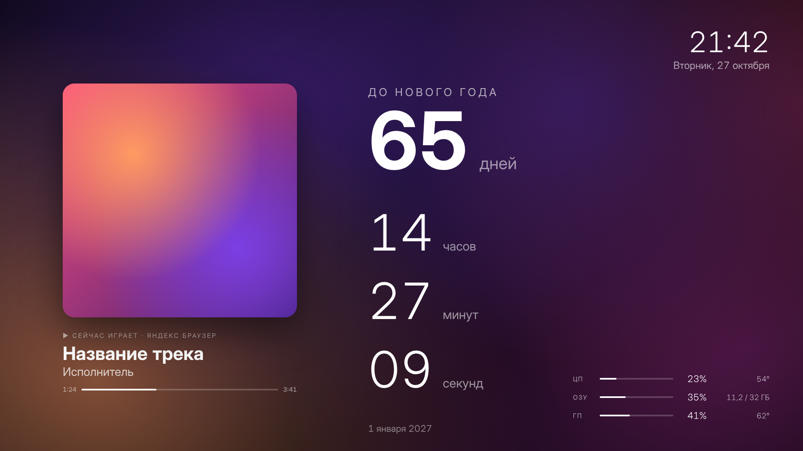
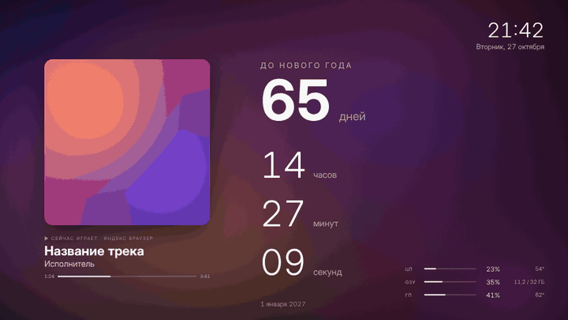

# Countdown Screensaver

Заставка для Windows 10/11 с обратным отсчётом до важной даты и карточкой «Сейчас играет» для Spotify и музыки из браузера.



<details>
<summary>Анимация живого фона (ускорено в 3 раза)</summary>



</details>

## Возможности

- **Обратный отсчёт** до любой даты и времени: дни, часы, минуты, секунды с правильными окончаниями («2 дня», «5 минут»). Когда момент наступает, вместо таймера показывается ваш текст.
- **«Сейчас играет»**: большая обложка, название, исполнитель, источник, статус «играет/пауза» и полоса прогресса трека.
- **Живой фон как у ambient-лампы**: мягкие цветные пятна медленно плывут и перетекают друг в друга. Цвета берутся из обложки текущего трека и плавно меняются при смене песни. На паузе фон приглушается.
- **Часы и дата** в правом верхнем углу.
- **Загрузка компьютера** в правом нижнем углу: процессор, оперативная память и видеокарта с температурами. Температура подсвечивается оранжевым от 80° и красным от 90°.
- Поддержка нескольких мониторов. Выход из заставки по движению мыши, клику или любой клавише.

### Откуда берётся музыка

| Источник | Как работает |
|---|---|
| Spotify, Chrome, Edge, Firefox, VLC, «Медиаплеер» и др. | Через системные медиаконтролы Windows (та же плашка, что появляется при регулировке громкости). Ничего настраивать не нужно. |
| Яндекс Браузер и другие браузеры, которые не передают трек в Windows | Через расширение из папки [`extension`](extension). Оно передаёт трек заставке только на ваш компьютер (`127.0.0.1`), в интернет ничего не уходит. |

## Установка

### 1. Сборка

1. Установите [.NET 10 SDK](https://dotnet.microsoft.com/download/dotnet/10.0) (один раз):
   ```powershell
   winget install Microsoft.DotNet.SDK.10 --source winget
   ```
   После установки перезапустите терминал.
2. Скачайте репозиторий (**Code → Download ZIP**) и распакуйте его.
3. Запустите `build.bat`.
4. Рядом появится `CountdownSaver.scr` размером около 60–70 МБ. Всё нужное уже внутри, дополнительно ничего ставить не придётся.

### 2. Установка заставки

1. Положите `CountdownSaver.scr` в постоянное место, потому что Windows запоминает путь к файлу.
2. Нажмите на файл правой кнопкой мыши и выберите **«Установить»**. Откроется окно «Параметры заставки», где заставка уже будет выбрана.
3. Нажмите **«Параметры»**, чтобы настроить:
   - заголовок («До Нового года»);
   - дату и время цели;
   - текст, который появится, когда время наступит;
   - показ часов, карточки «Сейчас играет», загрузки компьютера и выбор мониторов (все или только основной).

Чтобы проверить заставку сразу, нажмите на `.scr` правой кнопкой и выберите **«Тест»**.

### 3. Расширение для браузера (необязательно)

Нужно, если музыка играет в Яндекс Браузере или трек не появляется в системной плашке громкости.

1. Откройте страницу расширений: `browser://extensions` в Яндексе, `chrome://extensions` в Chrome, `edge://extensions` в Edge.
2. Включите **«Режим разработчика»**.
3. Нажмите **«Загрузить распакованное расширение»** и выберите папку `extension`.
4. Обновите (F5) вкладки с музыкой, которые уже были открыты.

Расширение работает на сайтах, которые сообщают браузеру название трека: Яндекс Музыка, YouTube, YouTube Music, VK Музыка, SoundCloud и большинство других.

## Температуры процессора и видеокарты

| Что показывается | Откуда берётся |
|---|---|
| Загрузка ЦП, ОЗУ, загрузка видеокарты | Напрямую из Windows, ничего настраивать не нужно |
| Температура видеокарты NVIDIA | Из драйвера NVIDIA, ничего настраивать не нужно |
| Температура процессора, видеокарт AMD и Intel | Из программы [LibreHardwareMonitor](https://github.com/LibreHardwareMonitor/LibreHardwareMonitor), если она запущена |

Windows не даёт обычной программе читать температуру процессора: для этого нужен драйвер с правами администратора. Чтобы заставка не требовала прав администратора, она берёт температуры у LibreHardwareMonitor.

1. Скачайте LibreHardwareMonitor со [страницы релизов](https://github.com/LibreHardwareMonitor/LibreHardwareMonitor/releases) и распакуйте.
2. Запустите `LibreHardwareMonitor.exe` **от имени администратора**.
3. В меню **Options** включите **Run On Windows Startup**, **Start Minimized** и **Minimize To Tray**, чтобы программа сама запускалась и не мешала.

Если LibreHardwareMonitor не запущен, температура процессора просто не показывается, а остальное работает как обычно.

## Если что-то не работает

Запустите заставку в отладочном режиме из папки с файлом:

```powershell
.\CountdownSaver.scr /w
```

Все ошибки также пишутся в журнал:

```powershell
notepad $env:APPDATA\CountdownSaver\error.log
```

Частые случаи:

- **Трек из браузера не виден.** Нажмите клавишу громкости или Win+A. Если там нет плеера, браузер не передаёт трек в Windows, поэтому установите расширение. В Chrome и Edge также проверьте, что в `chrome://flags` не отключён флаг «Hardware Media Key Handling».
- **Нет полосы прогресса.** Сайт не сообщает длительность трека. После обновления расширения нажмите в списке расширений кнопку «Обновить» (круглая стрелка) и перезагрузите вкладку.

## Удаление

1. Нажмите Win+R, введите `control desk.cpl,,@screensaver`, выберите **(нет)** и нажмите **OK**.
2. Удалите `CountdownSaver.scr`.
3. По желанию удалите папку с настройками `%APPDATA%\CountdownSaver`.
4. Удалите расширение на странице расширений браузера.

## Как устроено

| Файл | Назначение |
|---|---|
| `Program.cs` | Разбор аргументов Windows для заставок: `/s` запускает заставку, `/c` открывает настройки, `/p` превью, `/w` отладочный режим |
| `SaverWindow.xaml(.cs)` | Окно заставки: раскладка, таймер, карточка трека |
| `Ambient.cs` | Живой фон и извлечение палитры из обложки |
| `MediaWatcher.cs` | Получение трека из системных медиаконтролов Windows и из расширения |
| `SystemMonitor.cs` | Загрузка ЦП, ОЗУ, видеокарты и температуры |
| `BrowserBridge.cs` | Локальный приёмник данных от расширения на `127.0.0.1:38211` |
| `ConfigWindow.xaml(.cs)`, `Settings.cs` | Окно настроек и их хранение в `%APPDATA%\CountdownSaver\settings.json` |
| `extension/` | Расширение браузера (Manifest V3) |

Написано на C# / WPF (.NET 10).
